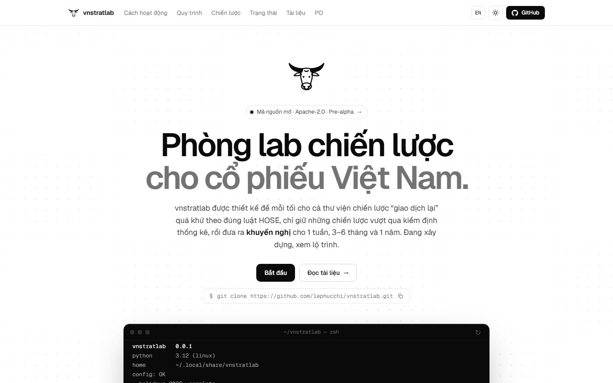
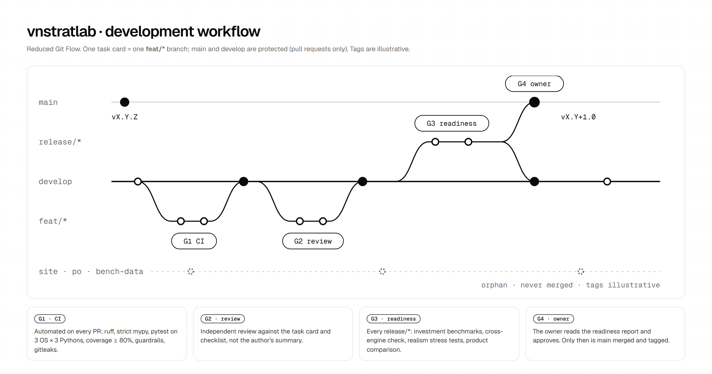

# vnstratlab

[](https://github.com/lephucchi/vnstratlab/actions/workflows/ci.yml)
[](LICENSE)


**A strategy lab for Vietnamese stocks.** Every trading evening it pulls market data, runs a
library of trading strategies through one realistic simulator, keeps only the strategies
that survive statistical tests, and turns them into **recommendations** for three horizons
(1 week, 3–6 months, 1 year).

> 🇻🇳 Đọc bằng tiếng Việt: [README.vi.md](README.vi.md)

**Website:** [lephucchi.github.io/vnstratlab](https://lephucchi.github.io/vnstratlab/) ·
**Docs:** [https://lephucchi.github.io/vnstratlab/docs/](https://lephucchi.github.io/vnstratlab/docs/)

[](https://lephucchi.github.io/vnstratlab/)

> [!IMPORTANT]
> **vnstratlab never places orders.** It has no broker connection and never will
> ([ADR-001](docs/adr/ADR-001-python-core-recommend-only.md)). It produces recommendations;
> you decide and place orders yourself in your broker's app. This is research software, not
> investment advice. Read [DISCLAIMER.md](DISCLAIMER.md).

---

## Why another backtester?

Most backtests lie, usually by accident. vnstratlab is built around three ideas:

1. **HOSE rules are first-class.** Settlement (T+), daily price limits (±7% ceiling/floor),
   round lots of 100 and odd lots, tick sizes, the 0.1% sales tax, fees and slippage are all
   modelled and covered by hand-computed tests. A buy cannot fill on a ceiling open, and a
   share bought Monday cannot be sold Tuesday.
2. **No single "best backtest".** Every strategy and parameter set is registered as a *trial*
   before it is run. Strategies are selected through two statistical gates
   (Deflated Sharpe Ratio, Probability of Backtest Overfitting, Hansen's SPA test) and a
   Model Confidence Set, then weighted with shrinkage toward equal weight. When nothing beats
   the benchmark, the recommendation is simply *hold the equal-weight benchmark*.
3. **Realism before release.** Each release passes stress tests (costs ×2/×3, delayed fills,
   liquidity caps, parameter noise, market regimes) and a cross-check against other
   backtesting engines (see [QA gates](docs/qa-gates.md)).

## Architecture

[](docs/architecture.md)

One engine and one nightly loop on your machine; the pipeline stops at a recommendation and
never reaches a broker. Details: [docs/architecture.md](docs/architecture.md) ·
[end-to-end flow](docs/end-to-end-flow.md). Image source:
[docs/assets/architecture.html](docs/assets/architecture.html).

## Status

**v0.1.0.** Data ingestion (synthetic market and an interim Yahoo adapter), data-quality checks,
adjusted and execution prices, features, the HOSE simulator with a risk layer, 19 registered
trials of 12 strategies, an offline `demo`, `init`, and a local Console (`serve`). The statistical
lab (`backtest`, `lab` cycle, gates, weights, `stress`, `daily`) and the scheduler are not built
yet and land in v0.2 and v0.3. Real-data results from the interim Yahoo source are not evidence
(survivorship bias, see [data gaps](docs/data-gaps.md)). See the [roadmap](docs/roadmap.md).

| Release | Scope |
|---|---|
| v0.1 (this release) | Data ingestion, simulator with HOSE rules, first strategies, offline `demo` |
| v0.2 | Walk-forward `backtest`, statistical lab: DSR, PBO, SPA, MCS, weights, meta-backtest, stress tests, reports |
| v0.3 | Paper books, local dashboard, built-in scheduler, optional Telegram report |
| v0.4 | News collection and LLM scoring, evaluated with a pre-registered test (ADR-002) |
| v0.5+ | Portfolio optimisation: shrinkage mean-variance, HRP, risk parity, Black-Litterman with lab views, lot-aware |

## Install

Not on PyPI yet. From source (Python 3.11 or newer):

```bash
git clone https://github.com/lephucchi/vnstratlab.git
cd vnstratlab
python -m venv .venv
# Windows: .venv\Scripts\activate    macOS/Linux: source .venv/bin/activate
pip install -e ".[dev]"
vnstratlab doctor
```

Once released: `uv tool install vnstratlab` or `pipx install vnstratlab`.

## Quick start

Available in v0.1.0:

```bash
vnstratlab doctor                        # check the installation
vnstratlab demo                          # whole pipeline on synthetic data, offline, ~45 s
vnstratlab serve                         # local Console on 127.0.0.1:8000: guide, runs, logs, results
vnstratlab init                          # create config.yaml (capital, data source, fee)
vnstratlab ingest --source synthetic     # fill the local store (or: --source yahoo, optional extra)
vnstratlab data rebuild                  # adjusted and execution prices
vnstratlab features build                # point-in-time features
vnstratlab lab register --dry-run        # list the 19 trials that would be registered
```

Planned (the commands exist but exit with "not implemented yet"):

```bash
vnstratlab backtest --strategy S02_breakout_volume   # v0.2
vnstratlab lab --horizon short                       # v0.2: gates -> MCS -> weights -> recommendation
vnstratlab stress --horizon short                    # v0.2
vnstratlab daily                                     # v0.3: the evening loop with a scheduler
```

| Command | What it does | Card |
|---|---|---|
| `doctor` | Version, paths, config, holidays, gaps, which secrets are set (never their values) | ✅ P1-T01 |
| `demo` | Full pipeline on a synthetic market, offline, in a temp folder | ✅ P1-T32 |
| `init` | Interactive setup of the user config | ✅ P1-T35 |
| `ingest` | Backfill or refresh market data (synthetic, Yahoo) | ✅ P1-T36, P1-T37 |
| `data status/rebuild/gaps` | Stores, checks, adjusted prices, gap register | ✅ P1-T06, P1-T38 |
| `features build` | Point-in-time features | ✅ P1-T10 |
| `lab trials/register` | Trial registry (19 trials) | ✅ P1-T13 |
| `runs list/show` | History of pipeline runs | ✅ P1-T27a |
| `serve` | Local Console (runs, logs, guide, results); no scheduler yet | ✅ P1-T27a, P1-T28a |
| `backtest` | Walk-forward backtest of one strategy | P1-T20 (v0.2) |
| `lab` (cycle) | One strategy-selection cycle for a horizon | P1-T22 (v0.2) |
| `meta-backtest` | Backtest the lab itself vs. naive selectors | P1-T23 (v0.2) |
| `stress` | Realism stress tests | P1-T33 (v0.2) |
| `daily` | The evening loop | P1-T26 (v0.3) |

`--dry-run` is supported by `ingest`, `data rebuild`, `features build`, `lab register`, the
`lab` cycle and `daily`. `demo` works in a temporary folder and writes nothing to your home.
There is no scheduler yet; it is planned for v0.3.

## Configuration and secrets

- **Parameters** (costs, risk limits, gate thresholds, strategy params) live in YAML. Packaged
  defaults are in [`src/vnstratlab/config/`](src/vnstratlab/config/); your overrides live in
  the app home.
- **Secrets** (Telegram token) come only from environment variables or
  a `.env` file. Copy [`.env.example`](.env.example). They are never committed, logged or shown.
- **Your data stays on your machine.** vnstratlab does not ship or redistribute market data.

Details: [docs/configuration.md](docs/configuration.md) · [docs/data-sources.md](docs/data-sources.md)

## Documentation

| Doc | For |
|---|---|
| [Getting started](docs/getting-started.md) | Users |
| [End-to-end flow](docs/end-to-end-flow.md) | Everyone |
| [Architecture](docs/architecture.md) | Contributors |
| [Engine specification](docs/engine.md) | Contributors |
| [Strategy catalogue](docs/strategies.md) | Everyone |
| [Configuration](docs/configuration.md) | Users |
| [Data sources](docs/data-sources.md) | Users, contributors |
| [Writing a strategy](docs/writing-strategies.md) | Users, contributors |
| [Benchmarks](docs/benchmarks.md) | Everyone |
| [Development workflow](docs/workflow.md) | Contributors, AI agents |
| [Git branching and releases](docs/git-branching.md) | Contributors, maintainers |
| [QA gates](docs/qa-gates.md) | Reviewers, maintainers |
| [Roadmap](docs/roadmap.md) | Everyone |
| [Implementation plan](docs/plan/plan.md) | Maintainers, AI agents |
| [Maintainer setup](docs/maintainers.md) | Maintainers |

## Development workflow

[](docs/git-branching.md)

Every change passes four gates; `main` and `develop` accept pull requests only. Details:
[git branching](docs/git-branching.md) · [QA gates](docs/qa-gates.md) ·
[workflow](docs/workflow.md). Image source: [docs/assets/workflow.html](docs/assets/workflow.html).

## Contributing

Read [CONTRIBUTING.md](CONTRIBUTING.md). In short: branch from `develop`, one task card per
branch, tests first, Conventional Commits, and every PR passes CI and an independent review.

## License

[Apache-2.0](LICENSE). Market data you download is subject to its provider's terms.
