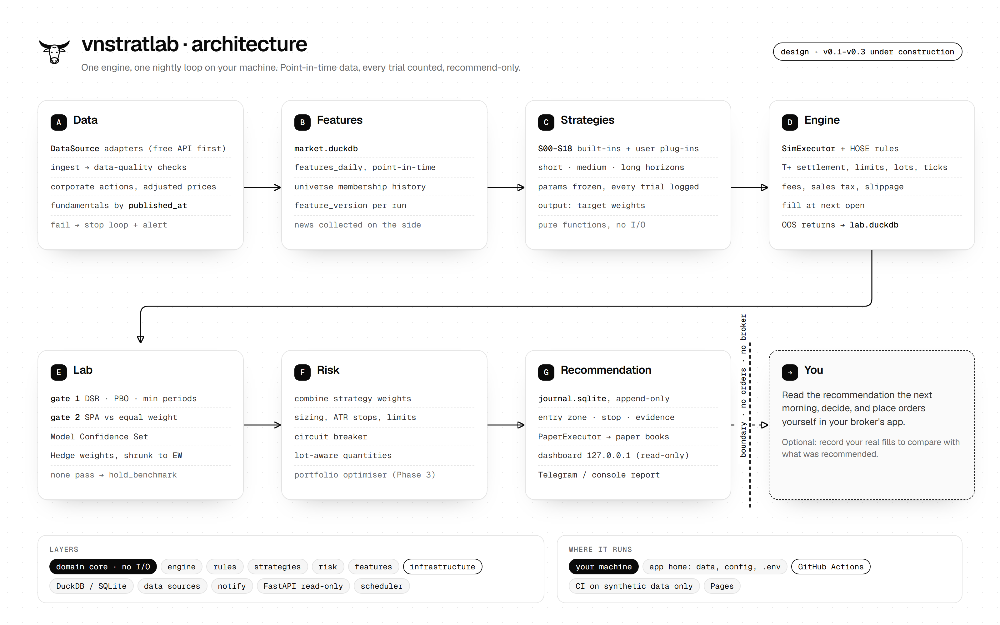

# vnstratlab

[](https://github.com/lephucchi/vnstratlab/actions/workflows/ci.yml)
[](LICENSE)


**A strategy lab for Vietnamese stocks.** Every trading evening it pulls market data, runs a
library of trading strategies through one realistic simulator, keeps only the strategies
that survive statistical tests, and turns them into **recommendations** for three horizons
(1 week, 3–6 months, 1 year).

> 🇻🇳 Đọc bằng tiếng Việt: [README.vi.md](README.vi.md)

**Website:** [lephucchi.github.io/vnstratlab](https://lephucchi.github.io/vnstratlab/) ·
**Docs:** [https://lephucchi.github.io/vnstratlab/docs/](https://lephucchi.github.io/vnstratlab/docs/)

[](https://lephucchi.github.io/vnstratlab/)

> [!IMPORTANT]
> **vnstratlab never places orders.** It has no broker connection and never will
> ([ADR-001](docs/adr/ADR-001-python-core-recommend-only.md)). It produces recommendations;
> you decide and place orders yourself in your broker's app. This is research software, not
> investment advice. Read [DISCLAIMER.md](DISCLAIMER.md).

---

## Why another backtester?

Most backtests lie, usually by accident. vnstratlab is built around three ideas:

1. **HOSE rules are first-class.** Settlement (T+), daily price limits (±7% ceiling/floor),
   round lots of 100 and odd lots, tick sizes, the 0.1% sales tax, fees and slippage are all
   modelled and covered by hand-computed tests. A buy cannot fill on a ceiling open, and a
   share bought Monday cannot be sold Tuesday.
2. **No single "best backtest".** Every strategy and parameter set is registered as a *trial*
   before it is run. Strategies are selected through two statistical gates
   (Deflated Sharpe Ratio, Probability of Backtest Overfitting, Hansen's SPA test) and a
   Model Confidence Set, then weighted with shrinkage toward equal weight. When nothing beats
   the benchmark, the recommendation is simply *hold the equal-weight benchmark*.
3. **Realism before release.** Each release passes stress tests (costs ×2/×3, delayed fills,
   liquidity caps, parameter noise, market regimes) and a cross-check against other
   backtesting engines (see [QA gates](docs/qa-gates.md)).

## Architecture

[](docs/architecture.md)

One engine and one nightly loop on your machine; the pipeline stops at a recommendation and
never reaches a broker. Details: [docs/architecture.md](docs/architecture.md) ·
[end-to-end flow](docs/end-to-end-flow.md). Image source:
[docs/assets/architecture.html](docs/assets/architecture.html).

## Status

Pre-alpha. The repository currently contains the scaffold (task card **P1-T01**).
See the [roadmap](docs/roadmap.md) for what lands in each release.

| Release | Scope |
|---|---|
| v0.1 | Data ingestion, simulator with HOSE rules, first strategies, `backtest`, offline `demo` |
| v0.2 | Statistical lab: DSR, PBO, SPA, MCS, weights, meta-backtest, stress tests, reports |
| v0.3 | Paper books, local dashboard, built-in scheduler, optional Telegram report |
| v0.4 | News collection and LLM scoring, evaluated with a pre-registered test (ADR-002) |
| v0.5+ | Portfolio optimisation: shrinkage mean-variance, HRP, risk parity, Black-Litterman with lab views, lot-aware |

## Install

Not on PyPI yet. From source:

```bash
git clone https://github.com/lephucchi/vnstratlab.git
cd vnstratlab
python -m venv .venv
# Windows: .venv\Scripts\activate    macOS/Linux: source .venv/bin/activate
pip install -e ".[dev]"
vnstratlab doctor
```

Once released: `uv tool install vnstratlab` or `pipx install vnstratlab`.

## Usage (target workflow)

```bash
vnstratlab demo                          # whole pipeline on synthetic data, offline
vnstratlab init                          # choose universe, capital, data dir, notifications
vnstratlab ingest --from 2015-01-01      # download market data to YOUR machine
vnstratlab backtest --strategy S02_breakout20
vnstratlab lab --horizon short           # gates -> MCS -> weights -> recommendation
vnstratlab stress --horizon short        # realism checks
vnstratlab serve                         # dashboard on 127.0.0.1:8000 + nightly scheduler
```

| Command | What it does | Card |
|---|---|---|
| `doctor` | Version, paths, which secrets are set (never their values) | ✅ P1-T01 |
| `demo` | Full pipeline on bundled synthetic data | P1-T32 |
| `init` | Interactive setup of the user config | P1-T35 |
| `ingest` | Backfill or refresh market data | P1-T03 |
| `backtest` | Walk-forward backtest of one strategy | P1-T20 |
| `lab` | One strategy-selection cycle for a horizon | P1-T22 |
| `meta-backtest` | Backtest the lab itself vs. naive selectors | P1-T23 |
| `stress` | Realism stress tests | P1-T33 |
| `daily` | The evening loop | P1-T26 |
| `serve` | Local dashboard and scheduler | P1-T27 |

Every command that writes supports `--dry-run`.

## Configuration and secrets

- **Parameters** (costs, risk limits, gate thresholds, strategy params) live in YAML. Packaged
  defaults are in [`src/vnstratlab/config/`](src/vnstratlab/config/); your overrides live in
  the app home.
- **Secrets** (data API key, Telegram token, LLM key) come only from environment variables or
  a `.env` file. Copy [`.env.example`](.env.example). They are never committed, logged or shown.
- **Your data stays on your machine.** vnstratlab does not ship or redistribute market data.

Details: [docs/configuration.md](docs/configuration.md) · [docs/data-sources.md](docs/data-sources.md)

## Documentation

| Doc | For |
|---|---|
| [Getting started](docs/getting-started.md) | Users |
| [End-to-end flow](docs/end-to-end-flow.md) | Everyone |
| [Architecture](docs/architecture.md) | Contributors |
| [Engine specification](docs/engine.md) | Contributors |
| [Strategy catalogue](docs/strategies.md) | Everyone |
| [Configuration](docs/configuration.md) | Users |
| [Data sources](docs/data-sources.md) | Users, contributors |
| [Writing a strategy](docs/writing-strategies.md) | Users, contributors |
| [Benchmarks](docs/benchmarks.md) | Everyone |
| [Development workflow](docs/workflow.md) | Contributors, AI agents |
| [Git branching and releases](docs/git-branching.md) | Contributors, maintainers |
| [QA gates](docs/qa-gates.md) | Reviewers, maintainers |
| [Roadmap](docs/roadmap.md) | Everyone |
| [Implementation plan](docs/plan/plan.md) | Maintainers, AI agents |
| [Maintainer setup](docs/maintainers.md) | Maintainers |

## Contributing

Read [CONTRIBUTING.md](CONTRIBUTING.md). In short: branch from `develop`, one task card per
branch, tests first, Conventional Commits, and every PR passes CI and an independent review.

## License

[Apache-2.0](LICENSE). Market data you download is subject to its provider's terms.
