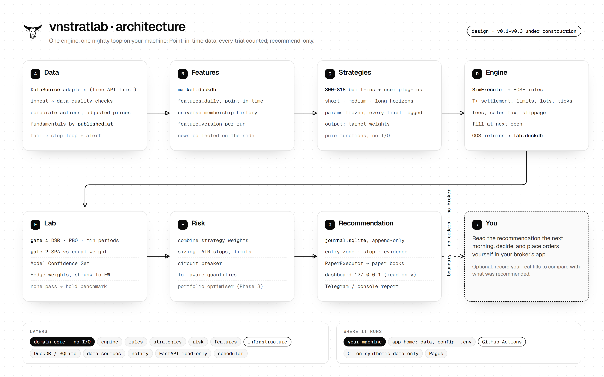
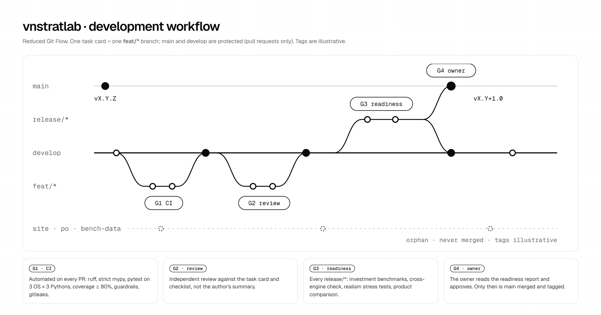

# vnstratlab

**Phòng lab chiến lược cho cổ phiếu Việt Nam.** Mỗi tối sau phiên giao dịch, vnstratlab tải dữ
liệu thị trường, chạy cả thư viện chiến lược qua cùng một bộ mô phỏng sát thực tế, chỉ giữ lại
những chiến lược vượt qua kiểm định thống kê, rồi đưa ra **khuyến nghị** cho ba khung thời gian:
ngắn hạn (1 tuần), trung hạn (3–6 tháng) và dài hạn (1 năm).

> 🇬🇧 English: [README.md](README.md)

**Website:** [lephucchi.github.io/vnstratlab](https://lephucchi.github.io/vnstratlab/) ·
**Tài liệu:** [https://lephucchi.github.io/vnstratlab/docs/](https://lephucchi.github.io/vnstratlab/docs/)

[](https://lephucchi.github.io/vnstratlab/)

> [!IMPORTANT]
> **vnstratlab không bao giờ đặt lệnh.** Phần mềm không kết nối với công ty chứng khoán nào
> và sẽ không bao giờ có chức năng này ([ADR-001](docs/adr/ADR-001-python-core-recommend-only.md)).
> Nó chỉ đưa ra khuyến nghị; bạn tự quyết định và tự đặt lệnh trên app của công ty chứng khoán.
> Đây là phần mềm nghiên cứu, không phải lời khuyên đầu tư. Đọc [DISCLAIMER.md](DISCLAIMER.md).

---

## Điểm khác biệt

1. **Mô phỏng đúng luật sàn HOSE.** Thanh toán T+, biên độ trần/sàn ±7%, lô chẵn 100 và lô lẻ,
   bước giá, thuế bán 0,1%, phí giao dịch và trượt giá đều được mô phỏng và có test tính tay.
   Lệnh mua không khớp được khi giá mở cửa đã ở trần; cổ phiếu mua thứ Hai không bán được vào
   thứ Ba.
2. **Không chọn "backtest đẹp nhất".** Mỗi bộ (chiến lược, tham số) được đăng ký là một *trial*
   trước khi chạy. Chiến lược phải qua hai cổng thống kê (Deflated Sharpe Ratio, xác suất
   overfit PBO, kiểm định SPA của Hansen) và Model Confidence Set, sau đó được phân bổ trọng số
   có co về chia đều. Nếu không chiến lược nào thắng mốc so sánh, khuyến nghị là *giữ danh mục
   chia đều*.
3. **Kiểm tra tính thực tế trước mỗi bản phát hành.** Stress test (phí ×2/×3, khớp lệnh trễ,
   giới hạn thanh khoản, nhiễu tham số, các giai đoạn thị trường) và đối chiếu chéo với các
   engine backtest khác ([QA gates](docs/qa-gates.md)).

## Kiến trúc

[](docs/architecture.md)

Một engine, một vòng lặp mỗi tối chạy trên máy của bạn; pipeline dừng ở khuyến nghị và không
bao giờ kết nối công ty chứng khoán. Chi tiết: [docs/architecture.md](docs/architecture.md) ·
[luồng end-to-end](docs/end-to-end-flow.md). Nguồn ảnh:
[docs/assets/architecture.html](docs/assets/architecture.html).

## Trạng thái

Pre-alpha. Repo hiện mới có khung dự án (task card **P1-T01**). Xem [lộ trình](docs/roadmap.md).

| Bản | Nội dung |
|---|---|
| v0.1 | Tải dữ liệu, bộ mô phỏng theo luật HOSE, các chiến lược đầu tiên, `backtest`, `demo` offline |
| v0.2 | Lab thống kê: DSR, PBO, SPA, MCS, trọng số, meta-backtest, stress test, báo cáo |
| v0.3 | Danh mục giả lập (paper book), dashboard chạy trên máy, lịch chạy tự động, báo cáo Telegram (tùy chọn) |
| v0.4 | Thu thập và chấm điểm tin tức bằng LLM, đánh giá bằng kiểm định đăng ký trước (ADR-002) |
| v0.5+ | Tối ưu danh mục: mean-variance có shrinkage, HRP, risk parity, Black-Litterman dùng tín hiệu của lab, có tính lô |

## Cài đặt

Chưa có trên PyPI. Cài từ mã nguồn:

```bash
git clone https://github.com/lephucchi/vnstratlab.git
cd vnstratlab
python -m venv .venv
# Windows: .venv\Scripts\activate    macOS/Linux: source .venv/bin/activate
pip install -e ".[dev]"
vnstratlab doctor
```

Khi đã phát hành: `uv tool install vnstratlab` hoặc `pipx install vnstratlab`.

## Cách dùng (mục tiêu)

```bash
vnstratlab demo                          # chạy toàn bộ trên dữ liệu giả, không cần mạng
vnstratlab init                          # chọn danh sách mã, vốn, thư mục dữ liệu, thông báo
vnstratlab ingest --from 2015-01-01      # tải dữ liệu về MÁY CỦA BẠN
vnstratlab backtest --strategy S02_breakout20
vnstratlab lab --horizon short           # cổng thống kê -> MCS -> trọng số -> khuyến nghị
vnstratlab stress --horizon short        # kiểm tra tính thực tế
vnstratlab serve                         # dashboard tại 127.0.0.1:8000 + lịch chạy mỗi tối
```

Mọi lệnh có ghi dữ liệu đều hỗ trợ `--dry-run`.

## Mỗi tối hệ thống làm gì (từ v0.3)

| Giờ | Bước |
|---|---|
| 15:30 | Tải dữ liệu, kiểm tra chất lượng; nếu lỗi thì dừng và báo |
| 16:00 | Tính các chỉ báo (features) |
| 16:15 | Lab: cập nhật kết quả ngoài mẫu; chọn lại trọng số vào ngày quyết định |
| 16:30 | Lớp quản trị rủi ro, ghi khuyến nghị vào nhật ký (không sửa được) |
| 17:00 | Cập nhật dashboard, gửi báo cáo |
| 17:15 | Thu thập tin tức thô |

**Bạn** đọc khuyến nghị, rồi tự đặt lệnh nếu đồng ý. Có thể ghi lại lệnh đã khớp vào nhật ký để
so sánh kết quả thật với khuyến nghị.

## Cấu hình và khóa bí mật

- **Tham số** (phí, giới hạn rủi ro, ngưỡng kiểm định, tham số chiến lược) nằm trong YAML.
- **Khóa bí mật** (khóa vnstock nếu cần, Telegram) chỉ đọc từ biến môi trường hoặc file `.env`
  (sao chép từ [`.env.example`](.env.example)). Không bao giờ commit, ghi log hay hiển thị.
- **Dữ liệu nằm trên máy bạn.** vnstratlab không phân phối lại dữ liệu giá.

## Tài liệu

Tài liệu kỹ thuật viết bằng tiếng Anh, nằm trong [docs/](docs/index.md): bắt đầu nhanh, kiến trúc,
cấu hình, nguồn dữ liệu, cách viết chiến lược, benchmark, quy trình phát triển, chia nhánh git,
các cổng QA và lộ trình.

## Quy trình phát triển

[](docs/git-branching.md)

Mọi thay đổi đi qua bốn cổng; `main` và `develop` chỉ nhận thay đổi qua pull request. Chi tiết:
[nhánh git](docs/git-branching.md) · [cổng QA](docs/qa-gates.md) ·
[quy trình](docs/workflow.md). Nguồn ảnh: [docs/assets/workflow.html](docs/assets/workflow.html).

## Đóng góp

Đọc [CONTRIBUTING.md](CONTRIBUTING.md). Tóm tắt: tạo nhánh từ `develop`, mỗi task card một nhánh,
viết test trước, commit theo Conventional Commits, và mọi PR phải qua CI cùng một lượt review
độc lập.

## Giấy phép

[Apache-2.0](LICENSE). Dữ liệu bạn tải về tuân theo điều khoản của nhà cung cấp dữ liệu đó.
